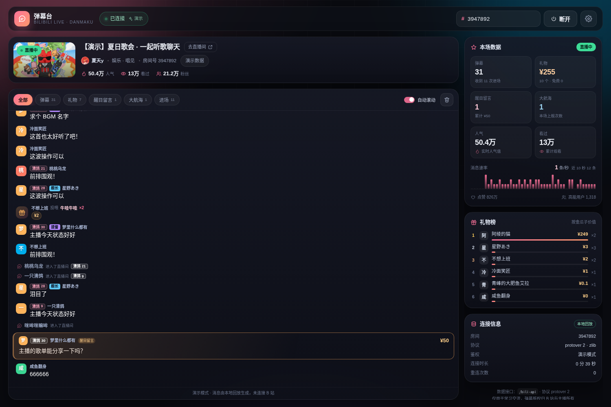

# 弹幕台 · B 站直播弹幕接收与展示

一个用 **Vite + React + TypeScript** 写的 B 站直播弹幕网页程序，底层使用
[`bilibili-ws-client`](https://github.com/varieget/bilibili-ws-client) 连接 B 站直播弹幕服务器，
支持弹幕、礼物、醒目留言（SC）、大航海、进场等事件，并内置了本地接口代理与一个可预览界面的演示模式。



## 功能

- **实时弹幕**：解析新版 `DANMU_MSG`，展示发送者**头像**、大表情、B 站小表情（`[大笑]`、`[dog]` 等会渲染成图片）、置顶弹幕、房管标记、粉丝勋章、舰长/提督/总督标识、彩色弹幕（自动提亮暗色）
- **礼物事件**：同时支持旧版 JSON 的 `SEND_GIFT` 与新版 protobuf 的 `SEND_GIFT_V2`，连击合并、礼物榜、右下角礼物浮层提醒
- **醒目留言**：`SUPER_CHAT_MESSAGE` 卡片展示金额与内容
- **大航海**：`GUARD_BUY` 上舰提示
- **进场互动**：`INTERACT_WORD` / `INTERACT_WORD_V2`（protobuf）进场、关注、分享
- **房间数据**：人气值、累计看过、点赞、高能用户、粉丝数、消息速率迷你图表
- **稳定连接**：断线自动重连（重新拉取 token）、指数退避、连接状态与重连次数展示
- **消息体验**：按类型筛选、自动滚动 / 回看历史、有新消息提醒、清空、消息条数与字号可调
- **演示模式**：无网络 / 房间没开播时，用真实抓取的样本事件回放预览界面
- **环境变量 + 设置面板**：房间号、演示模式、显示偏好等可持久化
- **分路由 / OBS 嵌入**：`/danmaku`、`/gift`、`/superchat`、`/stats` 四个独立视图，透明背景、可隐藏信息栏，支持 `?room=xxx` 直接指定房间

## 技术栈

| 用途 | 选择 |
| --- | --- |
| 构建 | Vite 8 + React 19 + TypeScript 5.9 |
| 包管理 | Yarn 4（`nodeLinker: node-modules`） |
| 弹幕客户端 | `bilibili-ws-client` 3.x |
| 压缩 | 浏览器端用 `pako` 顶替 Node 的 `zlib` |
| 样式 | 原生 CSS（暗色玻璃拟态 + B 站粉） |

## 快速开始

要求 Node.js >= 22（本项目在 Node 26 下开发）。

```bash
# 1. 安装依赖
yarn install

# 2. 启动开发服务器
yarn dev
# → http://127.0.0.1:5173

# 3. 生产构建 / 本地预览
yarn build
yarn preview   # → http://127.0.0.1:4173
```

打开页面后会自动连接 `.env` 里配置的默认房间；把左上角输入框里的房间号改掉，点「连接」即可。

> 也可以直接通过 URL 指定房间：`http://127.0.0.1:5173/?room=3947892`，
> 或进入演示模式：`http://127.0.0.1:5173/?demo=1`。

### 关于 Yarn

项目使用 Yarn 4，但为了兼容 Node 26 的 ESM 模块探测（会把 Yarn 的 `yarn.js` 误判为 ESM 而报
`Dynamic require of "util" is not supported`），仓库内放了一份 `.cjs` 版本的 Yarn：

- `.yarnrc.yml` 中 `yarnPath: .yarn/releases/yarn-4.18.1.cjs`
- `packageManager: yarn@1.22.22`（Corepack 先启动 Yarn 1，再通过 `yarnPath` 转发到 Yarn 4）
- `nodeLinker: node-modules`，依赖安装在普通的 `node_modules` 中
- 缓存放在项目内 `.yarn/cache`（已 gitignore）

如果你本机的 Yarn 4 可以直接运行，也不影响使用。

## 嵌入视图（分路由）

除了主界面 `/`，还提供了几个适合单独打开 / OBS 嵌入的视图，全部支持 `?room=xxx` 与 `?demo=1`。
所有弹幕列表**默认始终锚定在最新消息上、不可手动滚动**；只有显式传 `?scroll=1` 才开启滚动查看历史。

| 路径 | 内容 |
| --- | --- |
| `/danmaku` | **与主界面弹幕流完全一致**：同款消息行样式，默认显示全部消息（弹幕、礼物、SC、大航海、进场、点赞、系统）；**不包含顶部筛选栏**；默认深色背景，`?theme=transparent` 可做 OBS 透明弹幕层；`?chrome=0` 时整页不可交互 |
| `/gift` | 礼物动态 + 礼物榜 |
| `/superchat` | 醒目留言墙 |
| `/stats` | 数据看板（弹幕、礼物、SC、大航海、人气、看过、消息速率） |

通用参数：

| 参数 | 默认 | 说明 |
| --- | --- | --- |
| `room` | `.env` 的默认房间 | 房间号 / 短号 |
| `demo` | `0` | `1` 使用本地回放数据 |
| `theme` | `dark`（`/danmaku`）/ `transparent`（其他） | `transparent` 透明背景 / `dark` 深色背景 |
| `chrome` | `1` | `0` 隐藏顶部信息条与底部提示；`/danmaku` 下同时整页不可交互（纯展示） |
| `scroll` | `0` | `1` 允许手动滚动查看历史（默认始终锁定最新消息） |
| `font` | `14`（`/danmaku`）/ `15`（其他） | 弹幕字号（12–32） |
| `max` | `200`（`/danmaku`）/ `80`（其他） | 最多保留消息条数（20–500） |
| `enter` | `1`（`/danmaku`）/ `0`（其他） | `0` 隐藏进场 / 关注 / 分享 |
| `like` | `1`（`/danmaku`）/ `0`（其他） | `0` 隐藏点赞 |
| `guard` | `1` | `0` 隐藏大航海消息 |
| `sc` | `1` | `0` 隐藏醒目留言 |

示例：

```text
http://127.0.0.1:5173/danmaku?room=3947892                      # 和主界面一样，全部消息
http://127.0.0.1:5173/danmaku?room=3947892&theme=transparent     # OBS 透明弹幕层
http://127.0.0.1:5173/danmaku?room=3947892&font=18&max=300
http://127.0.0.1:5173/gift?room=3947892&chrome=0
http://127.0.0.1:5173/stats?room=3947892&theme=dark
http://127.0.0.1:5173/danmaku?room=3947892&scroll=1   # 允许手动滚动历史
```

OBS 使用方法：添加「浏览器」来源，填入上面的地址，宽高按需设置即可；透明背景下不要再加纯色背景层。

> 分路由是纯前端路由，`vite dev` / `vite preview` 会自动回退到 `index.html`；
> 部署到静态托管时请配置 history fallback（把未知路径重写到 `index.html`）。

## 环境变量

复制 `.env.example` 为 `.env`（仓库已包含一份默认 `.env`），所有变量都以 `VITE_` 开头：

| 变量 | 默认值 | 说明 |
| --- | --- | --- |
| `VITE_APP_TITLE` | `弹幕台` | 页面标题 |
| `VITE_DEFAULT_ROOM_ID` | `5440` | 默认房间号（支持短号） |
| `VITE_AUTO_CONNECT` | `true` | 打开页面是否自动连接 |
| `VITE_QUICK_ROOMS` | `7734200,21144080,3947892,5050` | 空状态下的快捷房间 |
| `VITE_PROTOVER` | `2` | 弹幕协议：`1` 明文 / `2` zlib（推荐）。浏览器端暂不支持 `3`（Brotli） |
| `VITE_MAX_MESSAGES` | `200` | 消息列表最多保留条数 |
| `VITE_SHOW_ENTER` | `true` | 显示进场 / 关注 / 分享消息 |
| `VITE_SHOW_LIKE` | `false` | 显示点赞消息 |
| `VITE_GIFT_TOAST_MIN` | `1000` | 礼物浮层提示阈值（金瓜子，1000 = 1 元） |
| `VITE_DEMO_MODE` | `false` | 默认进入演示模式 |
| `VITE_BILI_API_BASE` | `/bili-api` | 本地代理前缀 |
| `BILI_COOKIE` | 空 | **推荐**：服务端登录 Cookie，用于换登录态弹幕 token（不加 `VITE_` 前缀，不会进浏览器） |
| `BILI_UID` | 空 | 可选：Cookie 中没有 `DedeUserID` 时手动指定 uid |
| `VITE_BILI_UID` | 空 | 可选：浏览器端手动指定鉴权 uid |
| `VITE_BILI_BUVID` | 空 | 可选：浏览器端手动指定 `b_3` buvid |
| `VITE_BILI_TOKEN` | 空 | 可选：浏览器端手动指定弹幕 token |

### 鉴权字段 & 为什么有些昵称是 `取***`

弹幕服务器鉴权包里有三个身份字段，`bilibili-ws-client` 会把它们一起发过去：

| 字段 | 来源 | 说明 |
| --- | --- | --- |
| `uid` | Cookie / 手动配置 | 用户 id，访客为 `0` |
| `key` | `getDanmuInfo`（登录态）或 `getConf`（访客） | 弹幕 token |
| `buvid` | Cookie 的 `buvid3` 或 `x/frontend/finger/spi` | 设备标识 |

**昵称里的 `***` 是 B 站对未登录访客的脱敏**（部分账号即使登录也会因隐私设置 / 神秘人状态被隐藏），
不是本项目截断。主界面现在会完整展示昵称（超长自动换行），但脱敏需要登录态才能改善。

推荐在 `.env` 里配置服务端 Cookie（**不要加 `VITE_` 前缀**，避免打包进前端）：

```env
# 整段 Cookie，或只填 SESSDATA 的值都行
BILI_COOKIE=SESSDATA=xxxx; bili_jct=xxxx; DedeUserID=123456
# 可选：Cookie 里没有 DedeUserID 时手动指定
BILI_UID=123456
```

代理会用 Cookie 请求 `getDanmuInfo`（带 WBI 签名），拿到与 uid 绑定的 token；浏览器再用
`uid + key + buvid` 鉴权。Cookie 失效或触发风控时会自动退回访客模式，并在「连接信息 → 接口提示」里说明。

> 也可以手动配置 `VITE_BILI_UID` / `VITE_BILI_TOKEN` / `VITE_BILI_BUVID`，但 token 需要自己想办法获取，
> 一般直接用 `BILI_COOKIE` 更省事。所有凭据都只应写在本地 `.env`，不要提交到仓库。

## 工作原理

```
浏览器                          Vite 中间件（server/bilibiliApi.ts）           B 站
  │  GET /bili-api/room?roomId=N ────────────────▶  room_init / get_info
  │                                                  get_anchor_in_room / getConf(token)
  │                                                  x/frontend/finger/spi(buvid)
  │  ◀──────────────── { room, danmaku: { token, buvid } }
  │
  │  new Client({ roomid, uid, protover, buvid, key: token }) ──── WSS 直连 ─────▶ broadcastlv
  │  ◀──────────────── DANMU_MSG / SEND_GIFT(_V2) / SUPER_CHAT_MESSAGE ...
  │
  │  解析 → 批量合并（120ms 节流）→ React 渲染
```

几点说明：

1. **为什么需要本地代理**：`api.live.bilibili.com` 不返回 CORS 头，浏览器无法直接请求；
   `server/bilibiliApi.ts` 作为 Vite 中间件（`dev` 与 `preview` 均可用）代为请求并缓存结果，
   同时拿到弹幕鉴权 `token` 与 `buvid`。
2. **为什么用 pako**：`bilibili-ws-client` 的 ESM 构建会 `import zlib from 'zlib'`，
   浏览器里没有 Node 的 zlib。`vite.config.ts` 把 `zlib` 别名到 `src/lib/zlibShim.ts`（基于 pako 的
   `inflateSync`），因此协议固定为 `protover=2`（zlib 压缩）。库还依赖 `events`，同样在别名里替换为
   浏览器实现。
3. **新版事件是 protobuf**：2026 年起礼物/进场事件变成 `SEND_GIFT_V2` / `INTERACT_WORD_V2`，
   内容放在 base64 的 `pb` 字段里。`src/lib/protobuf.ts` 实现了一个极简通用解码器，
   `src/lib/parse.ts` 从中取出昵称、**头像**、礼物名、数量、单价、连击数等字段。
4. **头像来源**：弹幕头像在 `DANMU_MSG` 的 `info[0][15].user.base.face`（旧版在 `extra.user`），
   进场事件的头像在 protobuf `uinfo.base.face`，礼物事件的在 `SendGift.face`；取不到时会退化为
   首字母 + 随机配色的圆形头像。
5. **重连**：关闭了库自带的重连（`maxConnectTimes = 0`），由 `src/lib/useLiveRoom.ts` 统一管理：
   断线后按 1.2s → 2.4s → … → 15s 退避重连，每次重连都会重新拉取房间信息（token 会过期），
   最多 8 次，失败后展示错误并提供「立即重连」。
6. **性能**：消息先进缓冲区，120ms 合并一次再进 React；礼物连击在原位置累加；列表按上限裁剪；
   统计数字与礼物榜也做了同样的节流。

## 目录结构

```
.
├── index.html
├── vite.config.ts            # 别名（zlib / events）、代理插件、优化配置
├── .env / .env.example       # 环境变量
├── server/
│   └── bilibiliApi.ts        # 本地 B 站接口代理（房间信息 + token + buvid，带缓存）
├── shared/
│   └── api.ts                # 前后端共享的接口类型
└── src/
    ├── App.tsx               # 页面骨架与状态编排
    ├── config.ts             # 环境变量解析
    ├── types.ts              # 事件、统计、连接状态等类型
    ├── styles.css            # 全部样式
    ├── components/
    │   ├── TopBar.tsx        # 品牌 / 连接状态 / 房间号输入
    │   ├── RoomCard.tsx      # 直播间信息卡
    │   ├── Feed.tsx          # 筛选栏 + 消息流
    │   ├── EventRows.tsx     # 各类消息行（含头像、勋章、礼物、SC 等）
    │   ├── OverlayView.tsx   # /danmaku /gift /superchat /stats 嵌入视图
    │   ├── SidePanels.tsx    # 本场数据、礼物榜、连接信息
    │   ├── GiftToasts.tsx    # 右下角礼物浮层
    │   ├── SettingsDrawer.tsx
    │   └── icons.tsx
    └── lib/
        ├── useLiveRoom.ts    # 连接生命周期、重连、批处理、统计
        ├── parse.ts          # 原始 cmd → 统一事件
        ├── protobuf.ts       # 极简 protobuf 解码
        ├── feed.ts           # 列表合并 / 礼物榜排序
        ├── format.ts         # 数字、金额、颜色格式化
        ├── api.ts            # 调用本地代理
        ├── demo.ts           # 演示模式数据回放
        ├── settings.ts       # 设置持久化
        ├── router.ts         # 极简路径路由（主界面 / 嵌入视图）
        ├── overlayConfig.ts  # 嵌入视图的 URL 参数解析
        └── zlibShim.ts       # pako 版 zlib
```

## 常见问题

**Q：一直显示「连接失败 / 获取直播间信息失败」？**

- 确认是通过 `yarn dev` 或 `yarn preview` 启动的（代理随 Vite 中间件运行），不要直接双击打开 `dist/index.html`；
- B 站接口偶尔会返回 `code -352`（风控），脚本会自动重试；长时间失败可以换网络环境或稍后再试；
- 如果接口能通但拿不到 `token`，可以配置 `.env` 的 `BILI_COOKIE`（推荐）或手动填 `VITE_BILI_TOKEN`（见上文）。

**Q：连上了但很久没有弹幕？**

1. 房间本身可能很安静，换一个热门房间试试（页面空状态里有快捷房间）；
2. B 站对未登录的访客连接有概率限流，消息会变少；配置 `BILI_COOKIE` 使用登录态通常更稳定；
3. 部分网络会拦截 `broadcastlv.chat.bilibili.com:2245`，可换网络或用代理。

**Q：为什么 `VITE_PROTOVER=3` 不生效？**

浏览器端没有 Brotli 解压实现，`zlibShim` 会把 3 降级成 2 并给出警告。

**Q：想部署到静态托管？**

`dist` 是纯静态文件，但 `/bili-api` 代理需要 Node 环境。可以：
- 用 Node 服务器（如 Express / Hono / Fastify）复用 `server/bilibiliApi.ts` 的逻辑，再把 `dist` 托管出去；
- 或者自建一个反向代理指向 B 站接口，并通过 `VITE_BILI_API_BASE` 改成你的地址（相对路径或完整 URL 都支持）。

## 免责声明

本项目仅用于学习与个人研究，弹幕、礼物等内容版权归哔哩哔哩及主播所有。请遵守 B 站用户协议与弹幕礼仪，
不要用于商业用途或高频抓取。
